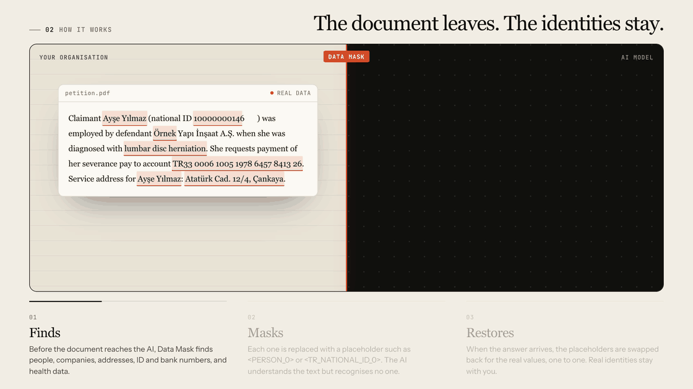
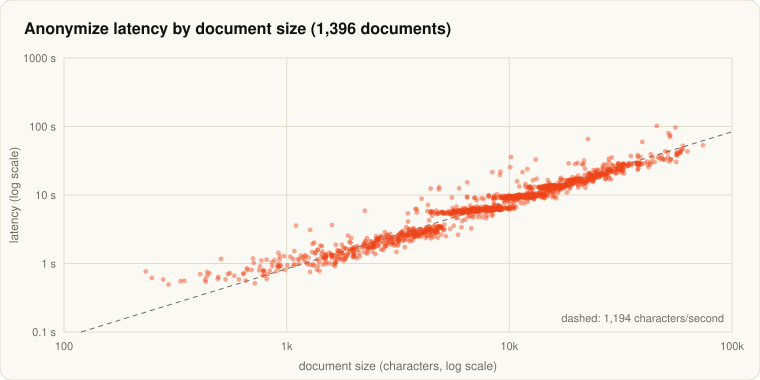
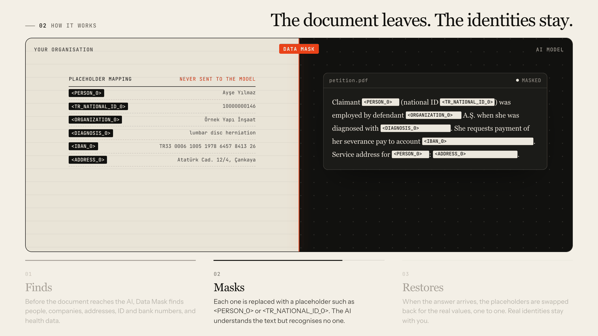
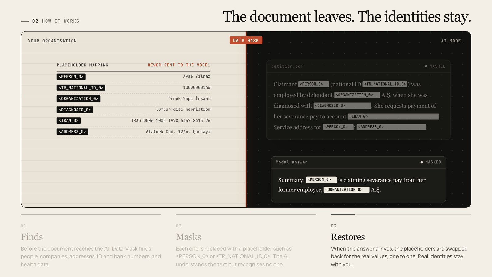
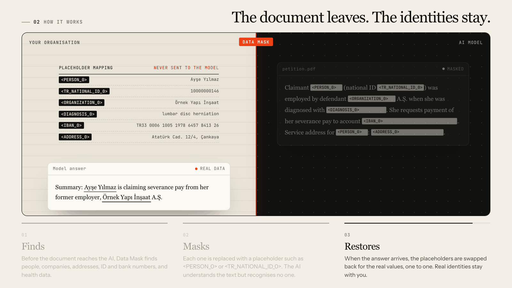

<div align="center">

# bbmask-bench

**A reproducible benchmark for [Data Mask](https://bbmask.co/en/) (`bb-mask`):<br>personal data masking for LLM pipelines, measured on Turkish court files.**

[](https://pypi.org/project/bb-mask/)
[](pyproject.toml)
[](LICENSE)

[Türkçe](docs/v0.1.0/README.tr.md) · [Full results](docs/v0.1.0/RESULTS.md) · [Methodology](docs/v0.1.0/METHODOLOGY.md) · [bbmask.co](https://bbmask.co/en/) · [SDK documentation](https://app.bbmask.co/#/sdk)

<a href="https://bbmask.co/en/#how-it-works"></a>

<sub>The flow as shown on <a href="https://bbmask.co/en/#how-it-works">bbmask.co</a>: find, mask, ask the model, restore.</sub>

</div>

## What this is

Data Mask sits between your application and a language model. Before a document leaves, it replaces names, ID numbers, IBANs and addresses with placeholders such as `<PERSON_0>`. When the model answers, it puts the real values back.

A layer like this makes two promises, and they pull against each other:

1. **Nothing that identifies a person reaches the model.**
2. **The model can still do its work**, and its answer comes back with every real value in place.

This repository measures both on whole court files, not hand-picked sentences: petitions and the attachments filed with them, from half a page to more than a hundred pages. We build Data Mask, so we publish everything needed to check us: the code, the [method](docs/v0.1.0/METHODOLOGY.md), a [result row for every document](results/full/documents.jsonl), and a command line tool that runs the same benchmark on your own documents.

## Results

<!-- BENCH:RESULTS:START -->
<sub>Generated by `bbmask-bench report` from [`results/full/summary.json`](results/full/summary.json). Do not edit by hand.</sub>

| Documents | Characters | Round trip exact | Provable identifiers masked | Median latency |
|---:|---:|---:|---:|---:|
| **1,396** | **16,743,851** | **100%** | **99.71%** | **6.7 s** |

Run: 1,397 documents in 338 case files, 17,076,238 characters. SDK `bb-mask 0.3.1`, options `placeholder_style=angle, keep_legal_form=False, health_data=False, llm_review=False, persist=False`, requests sent one at a time. Documents larger than 80 kB were not sent.

#### Provable identifiers

Values that can be recognized from the text alone, by a checksum or an explicit label. Each one found in the masked text is a leak.

| Identifier | Evidence | In documents | Occurrences | Left in masked text | Masked |
|---|---|---:|---:|---:|---:|
| `TR_NATIONAL_ID` | 11 digits, both check digits valid | 705 | 2,138 | 0 | **100%** |
| `EMAIL` | address syntax | 85 | 408 | 0 | **100%** |
| `PLATE` | plate format directly followed by the word “plaka” | 130 | 445 | 11 | **97.52%** |
| `PHONE` | Turkish mobile number format (5xx) | 212 | 759 | 0 | **100%** |
| `IBAN` | TR IBAN, ISO 13616 mod-97 valid | 30 | 64 | 0 | **100%** |

#### Round trip

`restore(anonymize(text))` returned the original text, character for character, for **1,396 of 1,396** documents (100%). Placeholders the mapping could not resolve: 0.

#### Consistency of masking

The service reports every value it masked. This table counts how often those same values appear in the original and how many of the occurrences are still readable after masking. “Other letter case” repeats the search ignoring case, for multi-word and numeric values only. A leftover is a real leak for names and numbers; for places and organizations it can also be an ordinary word that was masked once by mistake.

| Entity type | Values | Occurrences | Left readable | Consistent | Left readable (other letter case) |
|---|---:|---:|---:|---:|---:|
| `PERSON` | 13,117 | 43,399 | 30 | **99.93%** | 6 |
| `TR_CASE_NO` | 6,641 | 10,734 | 5 | **99.95%** | 5 |
| `ORGANIZATION` | 2,337 | 7,741 | 455 | **94.12%** | 60 |
| `LOCATION` | 2,845 | 3,734 | 212 | **94.32%** | 125 |
| `TR_NATIONAL_ID` | 1,811 | 2,205 | 1 | **99.95%** | 1 |
| `TR_LAND_REGISTRY` | 726 | 1,685 | 10 | **99.40%** | 13 |
| `TR_REGISTRY_NO` | 817 | 1,595 | 146 | **90.84%** | 146 |
| `DATE_OF_BIRTH` | 835 | 1,126 | 33 | **97.06%** | 32 |
| `PHONE_NUMBER` | 703 | 1,006 | 0 | **100%** | 0 |
| `TR_PLATE` | 324 | 738 | 13 | **98.23%** | 13 |
| `TR_TAX_ID` | 190 | 496 | 21 | **95.76%** | 21 |
| `EMAIL_ADDRESS` | 155 | 488 | 0 | **100%** | 0 |
| `TR_UETS` | 342 | 356 | 0 | **100%** | 0 |
| `BANK_ACCOUNT` | 94 | 229 | 65 | **71.61%** | 64 |
| `SENSITIVE_TERM` | 41 | 141 | 79 | **43.97%** | 2 |
| `TR_ID_DOCUMENT` | 54 | 75 | 8 | **89.33%** | 5 |
| `IBAN_CODE` | 54 | 70 | 0 | **100%** | 0 |
| `POSTAL_CODE` | 26 | 41 | 14 | **65.85%** | 14 |
| `TR_DRIVER_LICENSE` | 30 | 35 | 4 | **88.57%** | 4 |
| `TR_ETTN` | 21 | 28 | 0 | **100%** | 0 |
| `CARD_EXPIRY` | 11 | 21 | 8 | **61.90%** | 8 |
| `IP_ADDRESS` | 6 | 20 | 0 | **100%** | 0 |
| `TR_MERSIS` | 10 | 12 | 0 | **100%** | 0 |
| `CREDIT_CARD` | 8 | 10 | 0 | **100%** | 0 |

#### Second opinion from a language model

The checks above cannot see a value the service never detected. So the masked text of each document was also given to a language model (`gpt-6-luna`), which was asked to list the personal data it could still read. A finding counts only if its text is really in the masked document. This is an estimate, not a measurement: the model misses values, and it reports values that are not personal data. 1,396 documents were audited. Of 2,158 findings the model reported, 207 were rejected because their text was not in the document.

| Kind of data | Masked by the service | Still readable | of which never detected | of which masked elsewhere in the document | Documents affected | Estimated share masked |
|---|---:|---:|---:|---:|---:|---:|
| Person name | 29,180 | 273 | 207 | 66 | 106 | **99.07%** |
| National ID or passport number | 2,281 | 19 | 19 | 0 | 11 | **99.17%** |
| Phone number | 961 | 6 | 6 | 0 | 3 | **99.37%** |
| E-mail address | 468 | 0 | 0 | 0 | 0 | **100%** |
| IBAN, account or card number | 243 | 11 | 11 | 0 | 4 | **95.66%** |
| Licence plate | 684 | 21 | 11 | 10 | 14 | **97.02%** |
| Postal address | 3,135 | 394 | 232 | 162 | 133 | **88.83%** |
| Date of birth | 1,068 | 43 | 39 | 4 | 24 | **96.12%** |
| Other identifying number | 1,134 | 2,120 | 1,853 | 267 | 453 | **34.84%** |
| Company or other private entity | 4,678 | 370 | 331 | 39 | 49 | **92.67%** |

Not counted above: 22 readable names of authors cited as legal literature, in 10 documents. The service masks such names when it finds them, but they are public.

To test the auditor itself, 225 values that the service had masked in 40 documents were unmasked on purpose. The model reported 206 of them (91.55%). A leak the service leaves by itself can be harder to spot than a planted one, so the model probably finds a smaller share of the real ones.

#### What the model can still read

Masking must not destroy the text for the model. Share of legal-context expressions that are still present in the masked text:

| Expression | Example | In original | Still readable | Retained |
|---|---|---:|---:|---:|
| Statute reference | `2918 sayılı` | 8,130 | 7,694 | **94.63%** |
| Article reference | `91. maddesi` | 9,030 | 9,016 | **99.84%** |
| High court name | `Yargıtay` | 4,507 | 4,501 | **99.86%** |
| Date | `14.06.2017` | 18,278 | 17,353 | **94.93%** |
| Amount | `400.000,00 TL` | 5,398 | 5,360 | **99.29%** |
| Decision number | `2019/54321 E.` | 7,196 | 50 | **0.69%** |

On average **6.88%** of a document's characters are replaced by placeholders (median 4.87%).

#### Latency and throughput

Anonymize: p50 **6.7 s**, p90 21.9 s, p99 43.3 s. Throughput **1,194 characters/second**. Restore: p50 **120 ms**, p99 222 ms.

| Document size (characters) | Documents | p50 | p90 | p99 | max |
|---|---:|---:|---:|---:|---:|
| < 5k | 436 | 2.0 s | 3.4 s | 7.2 s | 13.0 s |
| 5k – 20k | 716 | 9.3 s | 14.0 s | 21.6 s | 35.9 s |
| 20k – 60k | 241 | 22.8 s | 35.7 s | 80.2 s | 102.1 s |
| ≥ 60k | 3 | 52.4 s | 53.4 s | 53.4 s | 53.4 s |



#### Reliability

**1,396 of 1,397** documents completed (99.92%). Failed: 1 (HTTP 504: 1); median size of a failed document: 332,387 characters.
<!-- BENCH:RESULTS:END -->

The two longest tables, entity counts by type and cost, are in the [full results](docs/v0.1.0/RESULTS.md).

### How to read these numbers

- **The round trip is exact.** All 1,396 documents came back character for character.
- **Identifiers that can be proven are masked.** No checksum-valid national ID, IBAN, e-mail address or mobile number stayed readable (0 of 3,369). Of 445 licence plates, 11 did.
- **Names are masked consistently.** Of 43,399 occurrences of the names the service found, 30 stayed readable. The language model found 273 more readable name occurrences in 106 documents, against 29,180 masked: an estimated 99%. Most are a first name standing alone. 106 are in four documents whose text has a space between every letter (`A h m e t`); there the service finds almost nothing, national ID numbers included.
- **The clearest gap is the registry numbers of judges and clerks.** Court decisions end with lines such as `Hakim 123456`. The service masks the name and usually leaves the number. A pattern check finds 1,095 such numbers in 252 documents; 953 are still readable. They are about half of the “Other identifying number” row. Most of the rest are workplace registry numbers of the social security agency.
- **Addresses are masked in part.** Street lines are masked. The name of a neighbourhood or a village often stays (394 occurrences in 133 documents).
- **Some rows look worse than they are.** In the consistency table, `BANK_ACCOUNT`, `TR_REGISTRY_NO`, `SENSITIVE_TERM` and `POSTAL_CODE` are low because the service once tagged an ordinary value, such as the year `2024` or the word `orman`, and the same value is readable elsewhere. That is over-masking, not a leak. In the audit table, 262 of the 370 company findings are one employer name, masked only in part, repeated in two service record tables.
- **The legal text survives.** Article references, high court names and amounts are kept above 99%, statute references and dates at about 95%. Case numbers are masked on purpose (99.31%). About 7% of a document's characters are replaced.
- **Speed.** About 1,200 characters per second: a median of 6.7 s per document, 43 s at the 99th percentile. `restore` takes about 120 ms.
- **Large documents were left out.** One document of 332,387 characters reached the service's 120-second limit and failed with HTTP 504. After that, documents above 80 kB were not sent: 13 more documents. Split a long document before you send it.

The language-model rows are estimates. The model missed 19 of 225 values that were unmasked on purpose to test it, so the real number of leftovers is somewhat higher than it reports.

## Why this matters when you use an LLM

**A prompt is a data transfer.** Whatever you put into a prompt leaves your systems. It travels to the model provider, where it may be logged, retained and reviewed. With a court file, that means the national ID numbers, bank accounts, addresses and health details of people who never agreed to any of it. Under KVKK and GDPR this is processing of personal data by a third party, usually in another country.

**Banning AI does not stop it, and asterisks break it.** People paste documents into chat tools because the tools are useful. Classic redaction (`**** ******`) protects the data and destroys the document: the model can no longer tell the claimant from the defendant, and nothing in its answer can be mapped back to a person.

**Reversible placeholders keep the document usable.** `<PERSON_0>` is the same person everywhere in the file. The model can still reason that `<PERSON_0>` claims severance pay from `<ORGANIZATION_0>`, and the answer is restored one to one.

**Masking first protects everything downstream.** Prompts do not stay in the model call. They end up in traces, evaluation sets, caches, vector stores and fine-tuning data. If the text is masked before the first call, all of those hold placeholders.

**None of this helps unless it is measured.** One missed ID number is a leak. One statute reference masked by mistake is a wrong answer. Before you put a masking layer in front of a model, you need both rates on documents like yours. That is what this benchmark is for.

## How Data Mask works

<table>
  <tr>
    <td width="50%"><br><sub><b>1. Find.</b> People, organisations, addresses, ID and bank numbers are located in the text.</sub></td>
    <td width="50%"><br><sub><b>2. Mask.</b> Each value becomes a placeholder. The mapping never goes to the model.</sub></td>
  </tr>
  <tr>
    <td><br><sub><b>3. Ask the model.</b> The model reads and answers in placeholders. Any model, called by your own code.</sub></td>
    <td><br><sub><b>4. Restore.</b> The placeholders in the answer are swapped back for the real values.</sub></td>
  </tr>
</table>

In code, this is one line before your model call and one line after it:

```python
import os
import bb_mask

bb_mask.init(api_key=os.environ["BB_ANONYM_TOKEN"])

tagged = bb_mask.anonymize(text)  # before the model
reply = my_llm(tagged.text)  # your own model call, unchanged
result = bb_mask.restore(tagged.doc_id, reply)  # after the model
```

With `persist=False` the service keeps nothing: the mapping is returned to you as `tagged.state`, and you pass it to `restore` yourself. The benchmark runs in this mode.

```bash
pip install bb-mask
```

There is also an npm package, a REST API and an on-premises installation. See [bbmask.co](https://bbmask.co/en/).

## What is measured

The corpus has no hand-made labels, so every metric is one that can be checked from the text itself.

| Question | Metric | How it is checked |
|---|---|---|
| Does the original come back? | Round trip | `restore(anonymize(text)) == text`, character for character. The whole masked document is given to `restore`, so every placeholder has to resolve. |
| Do hard identifiers leak? | Provable identifiers | National ID numbers with valid check digits, IBANs that pass mod-97, e-mail addresses, mobile numbers and labelled licence plates are found in the original and searched for in the masked text. |
| Is a value masked everywhere? | Consistency | The service reports each value it masked. Every one of them is searched for again in the masked text. |
| What did the service never notice? | Second opinion from a language model | The masked text is given to a language model, which lists the personal data it can still read. A finding counts only if its text is really in the document. This is an estimate, not a measurement. |
| Can the model still read the law? | Context retention | Statute and article references, court names, dates and amounts are counted before and after masking. |
| Is it fast and dependable? | Latency and reliability | Time per call by document size, characters per second, failed calls. |

What this benchmark does not measure:

- **Exact recall.** A name the service never found carries no checksum and is not in the mapping. Only the language-model audit can see it, and that audit is an estimate: the model overlooks values and reports some that are not personal data. An exact figure needs documents labelled by hand. The figure on bbmask.co (98.4% on 320 legal documents) comes from such a labelled evaluation. It is a different measurement on a different set and is not reproduced here.
- **The quality of a model's answers** on masked text. Context retention is a proxy for it.
- **File inputs and options.** The run sends plain text with the default options. PDF and Word input, multi-document calls, `llm_review`, `health_data` and `keep_legal_form` are not covered. The options are available as flags if you want to measure them.

The details, including every pattern used, are in the [methodology](docs/v0.1.0/METHODOLOGY.md).

## Run it on your own documents

You need Python 3.11 or newer and an API key from the [console](https://app.bbmask.co). Run the commands from the root of this repository.

```bash
python -m venv .venv && source .venv/bin/activate
pip install -e .
cp .env.example .env          # then put your key in BB_ANONYM_TOKEN
```

```bash
# 1. See what would be sent. No API calls.
bbmask-bench corpus --corpus path/to/documents

# 2. Try ten documents first.
bbmask-bench run --corpus path/to/documents --run-id mine --limit 10

# 3. Send the rest. The ten that are done are skipped.
bbmask-bench run --corpus path/to/documents --run-id mine

# 4. Optional: let a language model look for what is still readable.
#    Needs OPENAI_API_KEY and spends tokens. The masked text is sent to the model provider.
bbmask-bench audit mine --model <model-name>

# 5. Compute the metrics and print the report.
bbmask-bench report mine
```

The corpus is a directory of UTF-8 `.txt` files, one document per file, in any folder structure.

Things to know before you run it:

- **It spends credits.** `run` prints an estimate and asks before it sends anything. `--dry-run` shows the plan and sends nothing. `--max-credits N` caps the number of calls.
- **It resumes.** Run the same command with the same `--run-id` and finished documents are skipped. A document that was already paid for is never sent twice.
- **It stops when the connection is down.** After three connection failures in a row the run ends, so an outage does not use up your documents. Start it again to continue.
- **`runs/` holds personal data.** The masked text and the placeholder mapping of every document are kept there so that metrics can be computed offline. It is ignored by git. Do not publish it.
- **`results/` is safe to publish.** It holds counts, sizes and timings under hashed document ids. No text, no file names, no request ids.

`bbmask-bench run --help` lists the service options (`--llm-review`, `--health-data`, `--keep-legal-form`, `--placeholder-style`, `--persist`), so you can run the benchmark once per configuration and compare.

## Repository layout

```text
src/bbmask_bench/
  corpus.py      find documents, sample them deterministically
  runner.py      send documents, record every call, resume, stop on outages
  detectors.py   checksum-based detectors for Turkish identifiers
  metrics.py     the per-document metrics
  audit.py       second opinion from a language model, and a test of that model
  report.py      summary, tables and README blocks
  charts.py      SVG charts without dependencies
  cli.py         bbmask-bench corpus | run | audit | evaluate | report
tests/           unit tests; they use a fake client and make no API calls
results/full/    published results: summary.json, documents.jsonl, charts
docs/v0.1.0/     methodology, full results, Turkish README
assets/site/     frames of the product flow on bbmask.co
scripts/         capture_site_flow.py, which produced those frames
```

```bash
pip install -e ".[dev]"
ruff check . && pytest
```

## Links

- Product: [bbmask.co](https://bbmask.co/en/) · Console: [app.bbmask.co](https://app.bbmask.co)
- SDK: [PyPI](https://pypi.org/project/bb-mask/) · [npm](https://www.npmjs.com/package/bb-mask) · [source](https://github.com/bigbrains-company/bb-mask-sdk) · [documentation](https://app.bbmask.co/#/sdk)

## License

[MIT](LICENSE). Data Mask is a BigBrains product.
