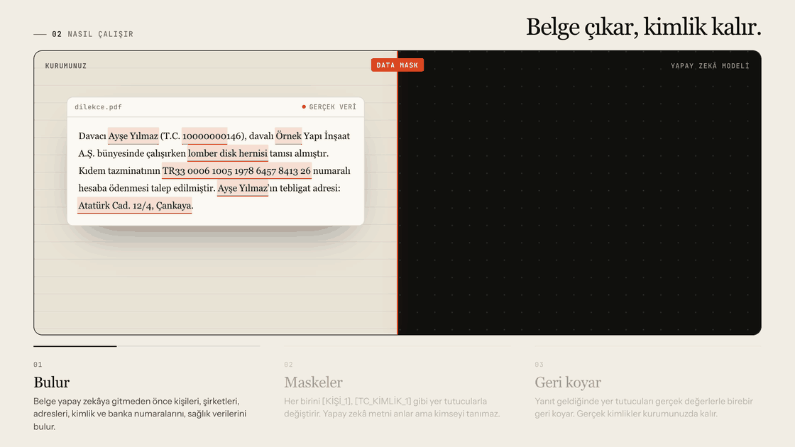
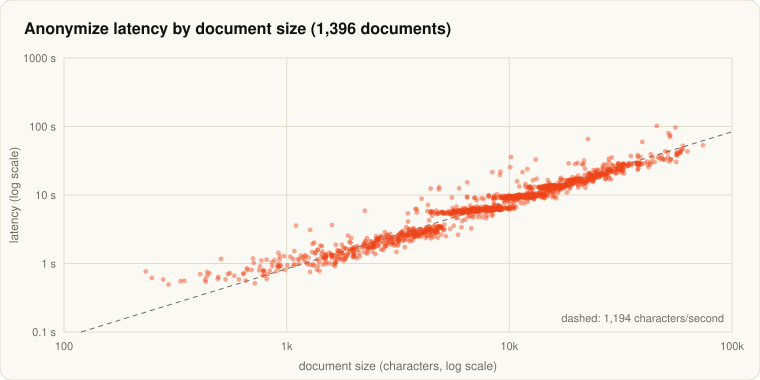
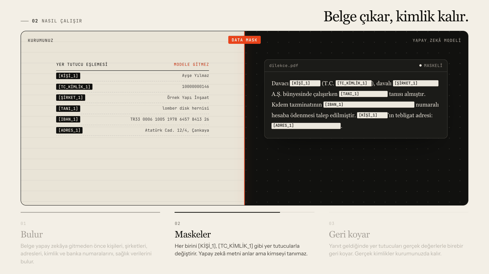
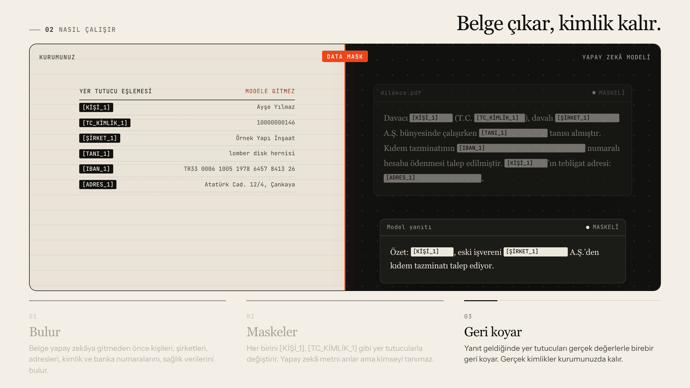
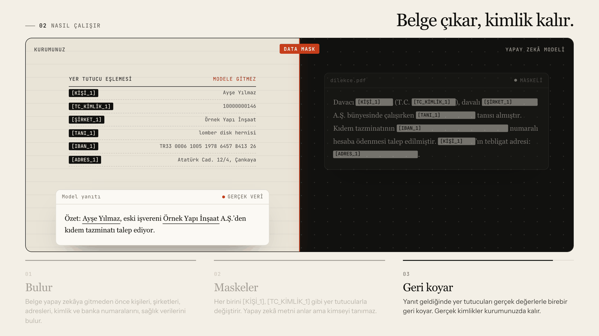

<div align="center">

# bbmask-bench

**[Data Mask](https://bbmask.co) (`bb-mask`) için tekrarlanabilir benchmark:<br>yapay zekâ uygulamalarında kişisel veri maskeleme, Türkçe dava dosyaları üzerinde ölçüldü.**

[](https://pypi.org/project/bb-mask/)
[](../../pyproject.toml)
[](../../LICENSE)

[English](../../README.md) · [Tüm sonuçlar](RESULTS.tr.md) · [Yöntem](METHODOLOGY.tr.md) · [bbmask.co](https://bbmask.co) · [SDK belgeleri](https://app.bbmask.co/#/sdk)

<a href="https://bbmask.co/#nasil-calisir"></a>

<sub><a href="https://bbmask.co/#nasil-calisir">bbmask.co</a>'daki akış: bul, maskele, modele sor, geri koy.</sub>

</div>

## Bu proje nedir

Data Mask, uygulamanız ile dil modeli arasında durur. Belge dışarı çıkmadan önce adları, kimlik numaralarını, IBAN'ları ve adresleri `<PERSON_0>` gibi yer tutucularla değiştirir. Model yanıt verdiğinde gerçek değerleri yerine geri koyar.

Böyle bir katman aynı anda iki söz verir ve bu iki söz birbirini zorlar:

1. **Kişiyi tanıtan hiçbir şey modele ulaşmaz.**
2. **Model işini yine yapabilir** ve yanıtı, bütün gerçek değerler yerinde olarak geri gelir.

Bu depo ikisini de seçilmiş cümlelerde değil, bütün dava dosyalarında ölçer: dilekçeler ve onlara eklenen belgeler, yarım sayfadan yüz sayfayı aşan metinlere kadar. Data Mask'i biz geliştiriyoruz. Bu yüzden bizi denetlemek için gereken her şeyi yayımlıyoruz: kodu, [yöntemi](METHODOLOGY.tr.md), [her belgenin sonuç satırını](../../results/full/documents.jsonl) ve aynı benchmark'ı kendi belgelerinizde çalıştıran komut satırı aracını.

## Sonuçlar

<!-- BENCH:RESULTS:START -->
<sub>`bbmask-bench report` tarafından [`../../results/full/summary.json`](../../results/full/summary.json) dosyasından üretilmiştir. Elle düzenlemeyin.</sub>

| Belge | Karakter | Birebir geri açma | Maskelenen kanıtlanabilir tanımlayıcı | Medyan süre |
|---:|---:|---:|---:|---:|
| **1.396** | **16.743.851** | **%100** | **%99,71** | **6,7 s** |

Koşu: 338 dava dosyasında 1.397 belge, 17.076.238 karakter. SDK `bb-mask 0.3.1`, seçenekler `placeholder_style=angle, keep_legal_form=False, health_data=False, llm_review=False, persist=False`, istekler tek tek gönderildi. 80 kB'tan büyük belgeler gönderilmedi.

#### Kanıtlanabilir tanımlayıcılar

Yalnızca metne bakarak, sağlama basamağı ya da açık bir etiketle tanınabilen değerler. Maskeli metinde bulunan her biri bir sızıntıdır.

| Tanımlayıcı | Kanıt | Belge | Geçiş | Maskeli metinde kalan | Maskelenen |
|---|---|---:|---:|---:|---:|
| `TR_NATIONAL_ID` | 11 hane, iki sağlama basamağı da geçerli | 705 | 2.138 | 0 | **%100** |
| `EMAIL` | adres sözdizimi | 85 | 408 | 0 | **%100** |
| `PLATE` | plaka biçimi ve hemen ardından “plaka” sözcüğü | 130 | 445 | 11 | **%97,52** |
| `PHONE` | Türkiye cep telefonu biçimi (5xx) | 212 | 759 | 0 | **%100** |
| `IBAN` | TR IBAN, ISO 13616 mod-97 geçerli | 30 | 64 | 0 | **%100** |

#### Gidiş-dönüş

`restore(anonymize(metin))`, **1.396 / 1.396** belgede özgün metni karakteri karakterine geri verdi (%100). Eşlemenin çözemediği yer tutucu: 0.

#### Maskeleme tutarlılığı

Servis maskelediği her değeri bildirir. Bu tablo, aynı değerlerin özgün metinde kaç kez geçtiğini ve maskelemeden sonra kaçının hâlâ okunabildiğini sayar. “Farklı harf büyüklüğü” sütunu aramayı büyük/küçük harfe bakmadan, yalnızca çok sözcüklü ve sayısal değerler için tekrarlar. Kalan bir geçiş, isim ve numaralarda gerçek sızıntıdır; yer ve kurum adlarında bir kez yanlışlıkla maskelenmiş sıradan bir sözcük de olabilir.

| Varlık türü | Değer | Geçiş | Okunabilir kalan | Tutarlılık | Okunabilir kalan (farklı harf büyüklüğü) |
|---|---:|---:|---:|---:|---:|
| `PERSON` | 13.117 | 43.399 | 30 | **%99,93** | 6 |
| `TR_CASE_NO` | 6.641 | 10.734 | 5 | **%99,95** | 5 |
| `ORGANIZATION` | 2.337 | 7.741 | 455 | **%94,12** | 60 |
| `LOCATION` | 2.845 | 3.734 | 212 | **%94,32** | 125 |
| `TR_NATIONAL_ID` | 1.811 | 2.205 | 1 | **%99,95** | 1 |
| `TR_LAND_REGISTRY` | 726 | 1.685 | 10 | **%99,40** | 13 |
| `TR_REGISTRY_NO` | 817 | 1.595 | 146 | **%90,84** | 146 |
| `DATE_OF_BIRTH` | 835 | 1.126 | 33 | **%97,06** | 32 |
| `PHONE_NUMBER` | 703 | 1.006 | 0 | **%100** | 0 |
| `TR_PLATE` | 324 | 738 | 13 | **%98,23** | 13 |
| `TR_TAX_ID` | 190 | 496 | 21 | **%95,76** | 21 |
| `EMAIL_ADDRESS` | 155 | 488 | 0 | **%100** | 0 |
| `TR_UETS` | 342 | 356 | 0 | **%100** | 0 |
| `BANK_ACCOUNT` | 94 | 229 | 65 | **%71,61** | 64 |
| `SENSITIVE_TERM` | 41 | 141 | 79 | **%43,97** | 2 |
| `TR_ID_DOCUMENT` | 54 | 75 | 8 | **%89,33** | 5 |
| `IBAN_CODE` | 54 | 70 | 0 | **%100** | 0 |
| `POSTAL_CODE` | 26 | 41 | 14 | **%65,85** | 14 |
| `TR_DRIVER_LICENSE` | 30 | 35 | 4 | **%88,57** | 4 |
| `TR_ETTN` | 21 | 28 | 0 | **%100** | 0 |
| `CARD_EXPIRY` | 11 | 21 | 8 | **%61,90** | 8 |
| `IP_ADDRESS` | 6 | 20 | 0 | **%100** | 0 |
| `TR_MERSIS` | 10 | 12 | 0 | **%100** | 0 |
| `CREDIT_CARD` | 8 | 10 | 0 | **%100** | 0 |

#### Dil modeliyle ikinci denetim

Yukarıdaki denetimler, servisin hiç fark etmediği bir değeri göremez. Bu yüzden her belgenin maskeli metni ayrıca bir dil modeline (`gpt-6-luna`) verildi ve hâlâ okuyabildiği kişisel verileri listelemesi istendi. Bir bulgu ancak metni gerçekten maskeli belgede geçiyorsa sayılır. Bu bir ölçüm değil, tahmindir: model bazı değerleri kaçırır, kişisel veri olmayan değerleri de bildirir. 1.396 belge denetlendi. Modelin bildirdiği 2.158 bulgudan 207 tanesi, metni belgede bulunmadığı için reddedildi.

| Veri türü | Servisin maskelediği | Okunabilir kalan | bunlardan hiç yakalanmayan | bunlardan belgenin başka yerinde maskelenen | Etkilenen belge | Tahmini maskeleme oranı |
|---|---:|---:|---:|---:|---:|---:|
| Kişi adı | 29.180 | 273 | 207 | 66 | 106 | **%99,07** |
| Kimlik veya pasaport numarası | 2.281 | 19 | 19 | 0 | 11 | **%99,17** |
| Telefon numarası | 961 | 6 | 6 | 0 | 3 | **%99,37** |
| E-posta adresi | 468 | 0 | 0 | 0 | 0 | **%100** |
| IBAN, hesap veya kart numarası | 243 | 11 | 11 | 0 | 4 | **%95,66** |
| Plaka | 684 | 21 | 11 | 10 | 14 | **%97,02** |
| Açık adres | 3.135 | 394 | 232 | 162 | 133 | **%88,83** |
| Doğum tarihi | 1.068 | 43 | 39 | 4 | 24 | **%96,12** |
| Diğer tanımlayıcı numara | 1.134 | 2.120 | 1.853 | 267 | 453 | **%34,84** |
| Şirket veya başka özel kuruluş | 4.678 | 370 | 331 | 39 | 49 | **%92,67** |

Yukarıda sayılmayan: 10 belgede, hukuk literatürü olarak atıf yapılan yazarların okunabilir kalan 22 adı. Servis bu adları bulduğunda maskeler, ancak bunlar kamuya açıktır.

Denetçinin kendisini sınamak için, servisin 40 belgede maskelediği 225 değer bilerek açıldı. Model bunlardan 206 tanesini bildirdi (%91,55). Servisin kendiliğinden bıraktığı bir sızıntı, bilerek açılandan daha zor fark edilebilir; yani model gerçek sızıntıların muhtemelen daha küçük bir bölümünü buluyor.

#### Modelin hâlâ okuyabildiği

Maskeleme, metni model için kullanılmaz hâle getirmemelidir. Maskeli metinde hâlâ bulunan hukuki bağlam ifadelerinin oranı:

| İfade | Örnek | Özgün metinde | Hâlâ okunabilir | Korunan |
|---|---|---:|---:|---:|
| Kanun atfı | `2918 sayılı` | 8.130 | 7.694 | **%94,63** |
| Madde atfı | `91. maddesi` | 9.030 | 9.016 | **%99,84** |
| Yüksek mahkeme adı | `Yargıtay` | 4.507 | 4.501 | **%99,86** |
| Tarih | `14.06.2017` | 18.278 | 17.353 | **%94,93** |
| Tutar | `400.000,00 TL` | 5.398 | 5.360 | **%99,29** |
| Karar/esas numarası | `2019/54321 E.` | 7.196 | 50 | **%0,69** |

Bir belgenin karakterlerinin ortalama **%6,88** kadarı yer tutucuyla değiştirilir (medyan %4,87).

#### Süre ve işlem hızı

Anonimleştirme: p50 **6,7 sn**, p90 21,9 sn, p99 43,3 sn. İşlem hızı **1.194 karakter/saniye**. Geri açma: p50 **120 ms**, p99 222 ms.

| Belge boyutu (karakter) | Belge | p50 | p90 | p99 | en uzun |
|---|---:|---:|---:|---:|---:|
| < 5k | 436 | 2,0 s | 3,4 s | 7,2 s | 13,0 s |
| 5k – 20k | 716 | 9,3 s | 14,0 s | 21,6 s | 35,9 s |
| 20k – 60k | 241 | 22,8 s | 35,7 s | 80,2 s | 102,1 s |
| ≥ 60k | 3 | 52,4 s | 53,4 s | 53,4 s | 53,4 s |



#### Güvenilirlik

**1.396 / 1.397** belge tamamlandı (%99,92). Başarısız: 1 (HTTP 504: 1); başarısız belgelerin medyan boyutu: 332.387 karakter.
<!-- BENCH:RESULTS:END -->

En uzun iki tablo, türlere göre varlık sayıları ve maliyet, [tüm sonuçlar](RESULTS.tr.md) sayfasındadır.

### Bu sayılar nasıl okunmalı

- **Gidiş-dönüş birebir.** 1.396 belgenin tamamı karakteri karakterine geri geldi.
- **Kanıtlanabilen tanımlayıcılar maskeleniyor.** Sağlama basamağı geçerli hiçbir kimlik numarası, IBAN, e-posta adresi veya cep telefonu okunabilir kalmadı (3.369'da 0). 445 plakadan 11'i kaldı.
- **Adlar tutarlı biçimde maskeleniyor.** Servisin bulduğu adların 43.399 geçişinden 30'u okunabilir kaldı. Dil modeli, 106 belgede okunabilir 273 ad geçişi daha buldu; maskelenen 29.180 geçişe karşı bu, tahminen %99 demektir. Çoğu tek başına duran bir ön addır. 106'sı, metni harf harf aralıklı yazılmış (`A h m e t`) dört belgededir; servis bu belgelerde, kimlik numaraları dahil, neredeyse hiçbir şey bulamıyor.
- **En belirgin açık, hâkim ve kâtip sicil numaralarında.** Mahkeme kararları `Hakim 123456` gibi satırlarla biter. Servis adı maskeliyor, numarayı çoğunlukla bırakıyor. Desenle yapılan denetim 252 belgede böyle 1.095 numara buluyor; 953'ü hâlâ okunabiliyor. Bunlar “Diğer tanımlayıcı numara” satırının yaklaşık yarısıdır. Kalanın çoğu SGK işyeri sicil numaralarıdır.
- **Adresler kısmen maskeleniyor.** Sokak ve kapı satırları maskeleniyor. Mahalle veya köy adı çoğu zaman kalıyor (133 belgede 394 geçiş).
- **Bazı satırlar olduğundan kötü görünüyor.** Tutarlılık tablosunda `BANK_ACCOUNT`, `TR_REGISTRY_NO`, `SENSITIVE_TERM` ve `POSTAL_CODE` düşük, çünkü servis `2024` yılı ya da `orman` sözcüğü gibi sıradan bir değeri bir kez etiketlemiş ve aynı değer başka yerde okunabiliyor. Bu bir sızıntı değil, fazladan maskelemedir. Denetim tablosundaki 370 kuruluş bulgusunun 262'si, yalnızca bir bölümü maskelenmiş tek bir işveren adının iki hizmet dökümünde yinelenmesidir.
- **Hukuki metin korunuyor.** Madde atıfları, yüksek mahkeme adları ve tutarlar %99'un üzerinde, kanun atıfları ve tarihler yaklaşık %95 oranında korunuyor. Dosya numaraları bilerek maskeleniyor (%99,31). Bir belgenin karakterlerinin yaklaşık %7'si değiştiriliyor.
- **Hız.** Saniyede yaklaşık 1.200 karakter: belge başına medyan 6,7 sn, 99. yüzdelikte 43 sn. `restore` yaklaşık 120 ms sürüyor.
- **Büyük belgeler kapsam dışı kaldı.** 332.387 karakterlik bir belge servisin 120 saniyelik sınırına takıldı ve HTTP 504 ile başarısız oldu. Bunun üzerine 80 kB'tan büyük belgeler gönderilmedi: 13 belge daha. Uzun bir belgeyi göndermeden önce bölün.

Dil modeli satırları tahmindir. Model, onu sınamak için bilerek açılan 225 değerden 19'unu kaçırdı; yani okunabilir kalanların gerçek sayısı, bildirdiğinden biraz yüksektir.

## Dil modeli kullanırken bu neden önemli

**Her istem bir veri aktarımıdır.** İsteme yazdığınız her şey sistemlerinizden çıkar. Model sağlayıcısına gider; orada kaydedilebilir, saklanabilir ve incelenebilir. Bir dava dosyasında bu, buna hiç onay vermemiş kişilerin kimlik numaraları, banka hesapları, adresleri ve sağlık bilgileri demektir. KVKK ve GDPR açısından bu, kişisel verinin üçüncü bir tarafça, çoğu zaman da yurt dışında işlenmesidir.

**Yapay zekâyı yasaklamak kullanımı durdurmaz, yıldızlamak ise belgeyi bozar.** İnsanlar belgeleri sohbet araçlarına yapıştırır, çünkü araçlar işe yarar. Klasik karartma (`**** ******`) veriyi korur ama belgeyi kullanılmaz kılar: model davacıyı davalıdan ayıramaz, yanıtındaki hiçbir şey de bir kişiye geri bağlanamaz.

**Geri açılabilir yer tutucular belgeyi kullanılır tutar.** `<PERSON_0>` dosyanın her yerinde aynı kişidir. Model, `<PERSON_0>` adlı kişinin `<ORGANIZATION_0>` adlı kurumdan kıdem tazminatı istediğini yine anlayabilir ve yanıt bire bir geri açılır.

**Önce maskelemek, sonraki her adımı da korur.** İstemler model çağrısında kalmaz. İzleme kayıtlarına, değerlendirme kümelerine, önbelleklere, vektör veritabanlarına ve ince ayar verisine de girer. Metin ilk çağrıdan önce maskelenirse bunların hepsinde yer tutucular durur.

**Ölçülmedikçe bunların hiçbiri güvence değildir.** Kaçan tek bir kimlik numarası bir sızıntıdır. Yanlışlıkla maskelenen tek bir kanun atfı yanlış bir yanıttır. Bir modelin önüne maskeleme katmanı koymadan önce, bu iki oranı kendi belgelerinize benzeyen belgelerde bilmeniz gerekir. Bu benchmark bunun için var.

## Data Mask nasıl çalışır

<table>
  <tr>
    <td width="50%"><br><sub><b>1. Bulur.</b> Kişiler, kurumlar, adresler, kimlik ve banka numaraları metinde bulunur.</sub></td>
    <td width="50%"><br><sub><b>2. Maskeler.</b> Her değer bir yer tutucuya dönüşür. Eşleme modele gitmez.</sub></td>
  </tr>
  <tr>
    <td><br><sub><b>3. Modele sorar.</b> Model yer tutucularla okur ve yanıtlar. Hangi model olursa olsun, çağrıyı sizin kodunuz yapar.</sub></td>
    <td><br><sub><b>4. Geri koyar.</b> Yanıttaki yer tutucular gerçek değerlerle değiştirilir.</sub></td>
  </tr>
</table>

Kodda bu, model çağrınızdan önce bir satır ve sonra bir satırdır:

```python
import os
import bb_mask

bb_mask.init(api_key=os.environ["BB_ANONYM_TOKEN"])

tagged = bb_mask.anonymize(text)  # modelden önce
reply = my_llm(tagged.text)  # kendi model çağrınız, değişmeden
result = bb_mask.restore(tagged.doc_id, reply)  # modelden sonra
```

`persist=False` ile servis hiçbir şey saklamaz: eşleme size `tagged.state` olarak döner, `restore` çağrısına siz verirsiniz. Benchmark bu kipte çalışır.

```bash
pip install bb-mask
```

Ayrıca npm paketi, REST API ve kurum içi kurulum da vardır. Ayrıntılar [bbmask.co](https://bbmask.co) adresinde.

## Neler ölçülüyor

Derlemde elle yapılmış etiket yoktur. Bu yüzden her ölçüm, metnin kendisinden doğrulanabilen bir ölçümdür.

| Soru | Ölçüm | Nasıl doğrulanır |
|---|---|---|
| Özgün metin geri geliyor mu? | Gidiş-dönüş | `restore(anonymize(metin)) == metin`, karakteri karakterine. `restore` çağrısına maskeli belgenin tamamı verilir; yani her yer tutucunun çözülmesi gerekir. |
| Kesin tanımlayıcılar sızıyor mu? | Kanıtlanabilir tanımlayıcılar | Sağlama basamakları geçerli T.C. kimlik numaraları, mod-97 denetiminden geçen IBAN'lar, e-posta adresleri, cep telefonu numaraları ve plaka olduğu metinde belirtilen plakalar özgün metinde bulunur ve maskeli metinde aranır. |
| Bir değer her yerde maskeleniyor mu? | Tutarlılık | Servis maskelediği her değeri bildirir. Bu değerlerin her biri maskeli metinde yeniden aranır. |
| Servis neyi hiç fark etmedi? | Dil modeliyle ikinci denetim | Maskeli metin bir dil modeline verilir; model hâlâ okuyabildiği kişisel verileri listeler. Bir bulgu ancak metni gerçekten belgede geçiyorsa sayılır. Bu bir ölçüm değil, tahmindir. |
| Model hukuki metni hâlâ okuyabiliyor mu? | Bağlamın korunması | Kanun ve madde atıfları, mahkeme adları, tarihler ve tutarlar maskelemeden önce ve sonra sayılır. |
| Hızlı ve güvenilir mi? | Süre ve güvenilirlik | Belge boyutuna göre çağrı süresi, saniyede işlenen karakter, başarısız çağrılar. |

Bu benchmark'ın ölçmedikleri:

- **Kesin yakalama oranı.** Servisin hiç bulamadığı bir ad sağlama basamağı taşımaz ve eşlemede yoktur. Onu yalnızca dil modeli denetimi görebilir; o denetim de bir tahmindir: model bazı değerleri kaçırır, kişisel veri olmayan bazı değerleri de bildirir. Kesin bir oran için elle etiketlenmiş belge gerekir. bbmask.co'daki oran (320 hukuk belgesinde %98,4) böyle etiketli bir değerlendirmeden gelir. O, başka bir belge kümesinde yapılmış başka bir ölçümdür ve burada yeniden üretilmemiştir.
- **Modelin maskeli metne verdiği yanıtların kalitesi.** Bağlamın korunması bunun dolaylı bir göstergesidir.
- **Dosya girdileri ve seçenekler.** Koşu, düz metni varsayılan seçeneklerle gönderir. PDF ve Word girdisi, çok belgeli çağrılar, `llm_review`, `health_data` ve `keep_legal_form` kapsam dışındadır. Ölçmek isterseniz bu seçenekler komut satırında bayrak olarak vardır.

Kullanılan bütün desenlerle birlikte ayrıntılar [yöntem](METHODOLOGY.tr.md) belgesindedir.

## Kendi belgelerinizde çalıştırın

Python 3.11 veya üstü ve [konsoldan](https://app.bbmask.co) alınmış bir API anahtarı gerekir. Komutlar depo kök dizininde çalıştırılır.

```bash
python -m venv .venv && source .venv/bin/activate
pip install -e .
cp .env.example .env          # sonra anahtarınızı BB_ANONYM_TOKEN alanına yazın
```

```bash
# 1. Neyin gönderileceğine bakın. API çağrısı yapılmaz.
bbmask-bench corpus --corpus belgelerin/yolu

# 2. Önce on belgeyle deneyin.
bbmask-bench run --corpus belgelerin/yolu --run-id deneme --limit 10

# 3. Kalanını gönderin. Biten on belge atlanır.
bbmask-bench run --corpus belgelerin/yolu --run-id deneme

# 4. İsteğe bağlı: hâlâ okunabilir kalanları bir dil modeline aratın.
#    OPENAI_API_KEY gerekir ve token harcar. Maskeli metin model sağlayıcısına gönderilir.
bbmask-bench audit deneme --model <model-adı>

# 5. Ölçümleri hesaplayın ve raporu yazdırın.
bbmask-bench report deneme --lang tr
```

Derlem, UTF-8 `.txt` dosyalarından oluşan bir dizindir. Her dosya bir belgedir; klasör yapısı serbesttir.

Çalıştırmadan önce bilinmesi gerekenler:

- **Kredi harcar.** `run`, bir şey göndermeden önce tahmini tutarı yazar ve onay ister. `--dry-run` planı gösterir, hiçbir şey göndermez. `--max-credits N` çağrı sayısını sınırlar.
- **Kaldığı yerden devam eder.** Aynı komutu aynı `--run-id` ile çalıştırın; biten belgeler atlanır. Ücreti ödenmiş bir belge ikinci kez gönderilmez.
- **Bağlantı kesilince durur.** Art arda üç bağlantı hatasından sonra koşu sona erer; böylece bir kesinti belgelerinizi boşa harcamaz. Devam etmek için yeniden başlatın.
- **`runs/` kişisel veri içerir.** Ölçümler çevrimdışı hesaplanabilsin diye her belgenin maskeli metni ve yer tutucu eşlemesi burada tutulur. Git tarafından yok sayılır. Yayımlamayın.
- **`results/` yayımlanabilir.** Özetlenmiş belge kimlikleri altında yalnızca sayılar, boyutlar ve süreler bulunur. Metin, dosya adı ve istek kimliği yoktur.

`bbmask-bench run --help` servis seçeneklerini listeler (`--llm-review`, `--health-data`, `--keep-legal-form`, `--placeholder-style`, `--persist`). Böylece benchmark'ı her yapılandırma için bir kez çalıştırıp sonuçları karşılaştırabilirsiniz.

## Depo yapısı

```text
src/bbmask_bench/
  corpus.py      belgeleri bulur, belirlenimli biçimde örnekler
  runner.py      belgeleri gönderir, her çağrıyı kaydeder, devam eder, kesintide durur
  detectors.py   Türkiye'ye özgü tanımlayıcılar için sağlama basamağı denetimleri
  metrics.py     belge başına ölçümler
  audit.py       dil modeliyle ikinci denetim ve o modelin sınanması
  report.py      özet, tablolar ve README blokları
  charts.py      bağımlılıksız SVG grafikler
  cli.py         bbmask-bench corpus | run | audit | evaluate | report
tests/           birim testleri; sahte istemci kullanır, API çağrısı yapmaz
results/full/    yayımlanan sonuçlar: summary.json, documents.jsonl, grafikler
docs/v0.1.0/     yöntem, tüm sonuçlar, Türkçe README
assets/site/     bbmask.co'daki ürün akışından kareler
scripts/         bu kareleri üreten capture_site_flow.py
```

```bash
pip install -e ".[dev]"
ruff check . && pytest
```

## Bağlantılar

- Ürün: [bbmask.co](https://bbmask.co) · Konsol: [app.bbmask.co](https://app.bbmask.co)
- SDK: [PyPI](https://pypi.org/project/bb-mask/) · [npm](https://www.npmjs.com/package/bb-mask) · [kaynak kod](https://github.com/bigbrains-company/bb-mask-sdk) · [belgeler](https://app.bbmask.co/#/sdk)

## Lisans

[MIT](../../LICENSE). Data Mask bir BigBrains ürünüdür.
