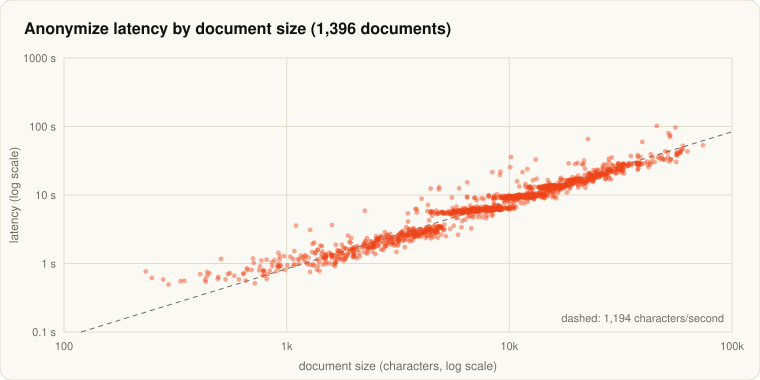
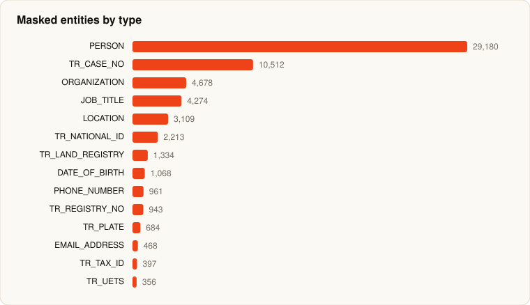

# Benchmark results

Generated by `bbmask-bench report` from [`../../results/full/summary.json`](../../results/full/summary.json). Do not edit by hand.

| Documents | Characters | Round trip exact | Provable identifiers masked | Median latency |
|---:|---:|---:|---:|---:|
| **1,396** | **16,743,851** | **100%** | **99.71%** | **6.7 s** |

Run: 1,397 documents in 338 case files, 17,076,238 characters. SDK `bb-mask 0.3.1`, options `placeholder_style=angle, keep_legal_form=False, health_data=False, llm_review=False, persist=False`, requests sent one at a time. Documents larger than 80 kB were not sent.

#### Provable identifiers

Values that can be recognized from the text alone, by a checksum or an explicit label. Each one found in the masked text is a leak.

| Identifier | Evidence | In documents | Occurrences | Left in masked text | Masked |
|---|---|---:|---:|---:|---:|
| `TR_NATIONAL_ID` | 11 digits, both check digits valid | 705 | 2,138 | 0 | **100%** |
| `EMAIL` | address syntax | 85 | 408 | 0 | **100%** |
| `PLATE` | plate format directly followed by the word “plaka” | 130 | 445 | 11 | **97.52%** |
| `PHONE` | Turkish mobile number format (5xx) | 212 | 759 | 0 | **100%** |
| `IBAN` | TR IBAN, ISO 13616 mod-97 valid | 30 | 64 | 0 | **100%** |

#### Round trip

`restore(anonymize(text))` returned the original text, character for character, for **1,396 of 1,396** documents (100%). Placeholders the mapping could not resolve: 0.

#### Consistency of masking

The service reports every value it masked. This table counts how often those same values appear in the original and how many of the occurrences are still readable after masking. “Other letter case” repeats the search ignoring case, for multi-word and numeric values only. A leftover is a real leak for names and numbers; for places and organizations it can also be an ordinary word that was masked once by mistake.

| Entity type | Values | Occurrences | Left readable | Consistent | Left readable (other letter case) |
|---|---:|---:|---:|---:|---:|
| `PERSON` | 13,117 | 43,399 | 30 | **99.93%** | 6 |
| `TR_CASE_NO` | 6,641 | 10,734 | 5 | **99.95%** | 5 |
| `ORGANIZATION` | 2,337 | 7,741 | 455 | **94.12%** | 60 |
| `LOCATION` | 2,845 | 3,734 | 212 | **94.32%** | 125 |
| `TR_NATIONAL_ID` | 1,811 | 2,205 | 1 | **99.95%** | 1 |
| `TR_LAND_REGISTRY` | 726 | 1,685 | 10 | **99.40%** | 13 |
| `TR_REGISTRY_NO` | 817 | 1,595 | 146 | **90.84%** | 146 |
| `DATE_OF_BIRTH` | 835 | 1,126 | 33 | **97.06%** | 32 |
| `PHONE_NUMBER` | 703 | 1,006 | 0 | **100%** | 0 |
| `TR_PLATE` | 324 | 738 | 13 | **98.23%** | 13 |
| `TR_TAX_ID` | 190 | 496 | 21 | **95.76%** | 21 |
| `EMAIL_ADDRESS` | 155 | 488 | 0 | **100%** | 0 |
| `TR_UETS` | 342 | 356 | 0 | **100%** | 0 |
| `BANK_ACCOUNT` | 94 | 229 | 65 | **71.61%** | 64 |
| `SENSITIVE_TERM` | 41 | 141 | 79 | **43.97%** | 2 |
| `TR_ID_DOCUMENT` | 54 | 75 | 8 | **89.33%** | 5 |
| `IBAN_CODE` | 54 | 70 | 0 | **100%** | 0 |
| `POSTAL_CODE` | 26 | 41 | 14 | **65.85%** | 14 |
| `TR_DRIVER_LICENSE` | 30 | 35 | 4 | **88.57%** | 4 |
| `TR_ETTN` | 21 | 28 | 0 | **100%** | 0 |
| `CARD_EXPIRY` | 11 | 21 | 8 | **61.90%** | 8 |
| `IP_ADDRESS` | 6 | 20 | 0 | **100%** | 0 |
| `TR_MERSIS` | 10 | 12 | 0 | **100%** | 0 |
| `CREDIT_CARD` | 8 | 10 | 0 | **100%** | 0 |

#### Second opinion from a language model

The checks above cannot see a value the service never detected. So the masked text of each document was also given to a language model (`gpt-6-luna`), which was asked to list the personal data it could still read. A finding counts only if its text is really in the masked document. This is an estimate, not a measurement: the model misses values, and it reports values that are not personal data. 1,396 documents were audited. Of 2,158 findings the model reported, 207 were rejected because their text was not in the document.

| Kind of data | Masked by the service | Still readable | of which never detected | of which masked elsewhere in the document | Documents affected | Estimated share masked |
|---|---:|---:|---:|---:|---:|---:|
| Person name | 29,180 | 273 | 207 | 66 | 106 | **99.07%** |
| National ID or passport number | 2,281 | 19 | 19 | 0 | 11 | **99.17%** |
| Phone number | 961 | 6 | 6 | 0 | 3 | **99.37%** |
| E-mail address | 468 | 0 | 0 | 0 | 0 | **100%** |
| IBAN, account or card number | 243 | 11 | 11 | 0 | 4 | **95.66%** |
| Licence plate | 684 | 21 | 11 | 10 | 14 | **97.02%** |
| Postal address | 3,135 | 394 | 232 | 162 | 133 | **88.83%** |
| Date of birth | 1,068 | 43 | 39 | 4 | 24 | **96.12%** |
| Other identifying number | 1,134 | 2,120 | 1,853 | 267 | 453 | **34.84%** |
| Company or other private entity | 4,678 | 370 | 331 | 39 | 49 | **92.67%** |

Not counted above: 22 readable names of authors cited as legal literature, in 10 documents. The service masks such names when it finds them, but they are public.

To test the auditor itself, 225 values that the service had masked in 40 documents were unmasked on purpose. The model reported 206 of them (91.55%). A leak the service leaves by itself can be harder to spot than a planted one, so the model probably finds a smaller share of the real ones.

#### What the model can still read

Masking must not destroy the text for the model. Share of legal-context expressions that are still present in the masked text:

| Expression | Example | In original | Still readable | Retained |
|---|---|---:|---:|---:|
| Statute reference | `2918 sayılı` | 8,130 | 7,694 | **94.63%** |
| Article reference | `91. maddesi` | 9,030 | 9,016 | **99.84%** |
| High court name | `Yargıtay` | 4,507 | 4,501 | **99.86%** |
| Date | `14.06.2017` | 18,278 | 17,353 | **94.93%** |
| Amount | `400.000,00 TL` | 5,398 | 5,360 | **99.29%** |
| Decision number | `2019/54321 E.` | 7,196 | 50 | **0.69%** |

On average **6.88%** of a document's characters are replaced by placeholders (median 4.87%).

#### Latency and throughput

Anonymize: p50 **6.7 s**, p90 21.9 s, p99 43.3 s. Throughput **1,194 characters/second**. Restore: p50 **120 ms**, p99 222 ms.

| Document size (characters) | Documents | p50 | p90 | p99 | max |
|---|---:|---:|---:|---:|---:|
| < 5k | 436 | 2.0 s | 3.4 s | 7.2 s | 13.0 s |
| 5k – 20k | 716 | 9.3 s | 14.0 s | 21.6 s | 35.9 s |
| 20k – 60k | 241 | 22.8 s | 35.7 s | 80.2 s | 102.1 s |
| ≥ 60k | 3 | 52.4 s | 53.4 s | 53.4 s | 53.4 s |

#### Reliability

**1,396 of 1,397** documents completed (99.92%). Failed: 1 (HTTP 504: 1); median size of a failed document: 332,387 characters.

#### What was masked

60,666 placeholders across 1,396 documents (median 27 per document).

| Entity type | Placeholders | Documents |
|---|---:|---:|
| `PERSON` | 29,180 | 1,309 |
| `TR_CASE_NO` | 10,512 | 1,063 |
| `ORGANIZATION` | 4,678 | 690 |
| `JOB_TITLE` | 4,274 | 1,059 |
| `LOCATION` | 3,109 | 877 |
| `TR_NATIONAL_ID` | 2,213 | 723 |
| `TR_LAND_REGISTRY` | 1,334 | 195 |
| `DATE_OF_BIRTH` | 1,068 | 356 |
| `PHONE_NUMBER` | 961 | 338 |
| `TR_REGISTRY_NO` | 943 | 668 |
| `TR_PLATE` | 684 | 173 |
| `EMAIL_ADDRESS` | 468 | 104 |
| `TR_TAX_ID` | 397 | 128 |
| `TR_UETS` | 356 | 178 |
| `BANK_ACCOUNT` | 161 | 63 |
| `IBAN_CODE` | 70 | 32 |
| `TR_ID_DOCUMENT` | 68 | 39 |
| `SENSITIVE_TERM` | 49 | 32 |
| `TR_DRIVER_LICENSE` | 30 | 29 |
| `TR_ETTN` | 28 | 17 |
| `POSTAL_CODE` | 26 | 24 |
| `IP_ADDRESS` | 20 | 2 |
| `CARD_EXPIRY` | 13 | 9 |
| `TR_MERSIS` | 12 | 9 |
| `CREDIT_CARD` | 10 | 8 |
| `CARD_CVV` | 2 | 2 |

#### Cost

174.17 credits for 1,396 documents: 0.125 per document, 10.40 per million characters. Pricing, as published by the service at `/health`: 0.01 credits per started 1,000 characters. The balance returned by the service matched this rule on 1,387 of 1,387 consecutive calls.
