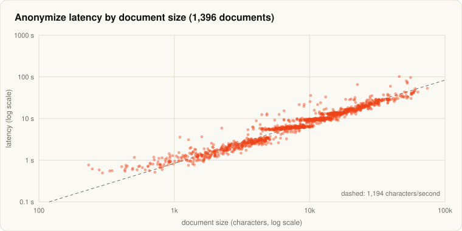
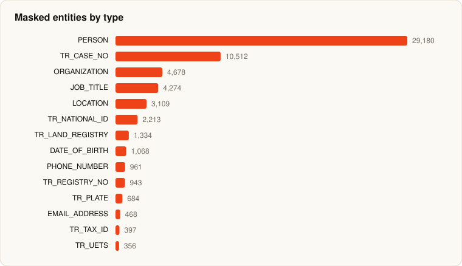

# Benchmark sonuçları

`bbmask-bench report` tarafından [`../../results/full/summary.json`](../../results/full/summary.json) dosyasından üretilmiştir. Elle düzenlemeyin.

| Belge | Karakter | Birebir geri açma | Maskelenen kanıtlanabilir tanımlayıcı | Medyan süre |
|---:|---:|---:|---:|---:|
| **1.396** | **16.743.851** | **%100** | **%99,71** | **6,7 s** |

Koşu: 338 dava dosyasında 1.397 belge, 17.076.238 karakter. SDK `bb-mask 0.3.1`, seçenekler `placeholder_style=angle, keep_legal_form=False, health_data=False, llm_review=False, persist=False`, istekler tek tek gönderildi. 80 kB'tan büyük belgeler gönderilmedi.

#### Kanıtlanabilir tanımlayıcılar

Yalnızca metne bakarak, sağlama basamağı ya da açık bir etiketle tanınabilen değerler. Maskeli metinde bulunan her biri bir sızıntıdır.

| Tanımlayıcı | Kanıt | Belge | Geçiş | Maskeli metinde kalan | Maskelenen |
|---|---|---:|---:|---:|---:|
| `TR_NATIONAL_ID` | 11 hane, iki sağlama basamağı da geçerli | 705 | 2.138 | 0 | **%100** |
| `EMAIL` | adres sözdizimi | 85 | 408 | 0 | **%100** |
| `PLATE` | plaka biçimi ve hemen ardından “plaka” sözcüğü | 130 | 445 | 11 | **%97,52** |
| `PHONE` | Türkiye cep telefonu biçimi (5xx) | 212 | 759 | 0 | **%100** |
| `IBAN` | TR IBAN, ISO 13616 mod-97 geçerli | 30 | 64 | 0 | **%100** |

#### Gidiş-dönüş

`restore(anonymize(metin))`, **1.396 / 1.396** belgede özgün metni karakteri karakterine geri verdi (%100). Eşlemenin çözemediği yer tutucu: 0.

#### Maskeleme tutarlılığı

Servis maskelediği her değeri bildirir. Bu tablo, aynı değerlerin özgün metinde kaç kez geçtiğini ve maskelemeden sonra kaçının hâlâ okunabildiğini sayar. “Farklı harf büyüklüğü” sütunu aramayı büyük/küçük harfe bakmadan, yalnızca çok sözcüklü ve sayısal değerler için tekrarlar. Kalan bir geçiş, isim ve numaralarda gerçek sızıntıdır; yer ve kurum adlarında bir kez yanlışlıkla maskelenmiş sıradan bir sözcük de olabilir.

| Varlık türü | Değer | Geçiş | Okunabilir kalan | Tutarlılık | Okunabilir kalan (farklı harf büyüklüğü) |
|---|---:|---:|---:|---:|---:|
| `PERSON` | 13.117 | 43.399 | 30 | **%99,93** | 6 |
| `TR_CASE_NO` | 6.641 | 10.734 | 5 | **%99,95** | 5 |
| `ORGANIZATION` | 2.337 | 7.741 | 455 | **%94,12** | 60 |
| `LOCATION` | 2.845 | 3.734 | 212 | **%94,32** | 125 |
| `TR_NATIONAL_ID` | 1.811 | 2.205 | 1 | **%99,95** | 1 |
| `TR_LAND_REGISTRY` | 726 | 1.685 | 10 | **%99,40** | 13 |
| `TR_REGISTRY_NO` | 817 | 1.595 | 146 | **%90,84** | 146 |
| `DATE_OF_BIRTH` | 835 | 1.126 | 33 | **%97,06** | 32 |
| `PHONE_NUMBER` | 703 | 1.006 | 0 | **%100** | 0 |
| `TR_PLATE` | 324 | 738 | 13 | **%98,23** | 13 |
| `TR_TAX_ID` | 190 | 496 | 21 | **%95,76** | 21 |
| `EMAIL_ADDRESS` | 155 | 488 | 0 | **%100** | 0 |
| `TR_UETS` | 342 | 356 | 0 | **%100** | 0 |
| `BANK_ACCOUNT` | 94 | 229 | 65 | **%71,61** | 64 |
| `SENSITIVE_TERM` | 41 | 141 | 79 | **%43,97** | 2 |
| `TR_ID_DOCUMENT` | 54 | 75 | 8 | **%89,33** | 5 |
| `IBAN_CODE` | 54 | 70 | 0 | **%100** | 0 |
| `POSTAL_CODE` | 26 | 41 | 14 | **%65,85** | 14 |
| `TR_DRIVER_LICENSE` | 30 | 35 | 4 | **%88,57** | 4 |
| `TR_ETTN` | 21 | 28 | 0 | **%100** | 0 |
| `CARD_EXPIRY` | 11 | 21 | 8 | **%61,90** | 8 |
| `IP_ADDRESS` | 6 | 20 | 0 | **%100** | 0 |
| `TR_MERSIS` | 10 | 12 | 0 | **%100** | 0 |
| `CREDIT_CARD` | 8 | 10 | 0 | **%100** | 0 |

#### Dil modeliyle ikinci denetim

Yukarıdaki denetimler, servisin hiç fark etmediği bir değeri göremez. Bu yüzden her belgenin maskeli metni ayrıca bir dil modeline (`gpt-6-luna`) verildi ve hâlâ okuyabildiği kişisel verileri listelemesi istendi. Bir bulgu ancak metni gerçekten maskeli belgede geçiyorsa sayılır. Bu bir ölçüm değil, tahmindir: model bazı değerleri kaçırır, kişisel veri olmayan değerleri de bildirir. 1.396 belge denetlendi. Modelin bildirdiği 2.158 bulgudan 207 tanesi, metni belgede bulunmadığı için reddedildi.

| Veri türü | Servisin maskelediği | Okunabilir kalan | bunlardan hiç yakalanmayan | bunlardan belgenin başka yerinde maskelenen | Etkilenen belge | Tahmini maskeleme oranı |
|---|---:|---:|---:|---:|---:|---:|
| Kişi adı | 29.180 | 273 | 207 | 66 | 106 | **%99,07** |
| Kimlik veya pasaport numarası | 2.281 | 19 | 19 | 0 | 11 | **%99,17** |
| Telefon numarası | 961 | 6 | 6 | 0 | 3 | **%99,37** |
| E-posta adresi | 468 | 0 | 0 | 0 | 0 | **%100** |
| IBAN, hesap veya kart numarası | 243 | 11 | 11 | 0 | 4 | **%95,66** |
| Plaka | 684 | 21 | 11 | 10 | 14 | **%97,02** |
| Açık adres | 3.135 | 394 | 232 | 162 | 133 | **%88,83** |
| Doğum tarihi | 1.068 | 43 | 39 | 4 | 24 | **%96,12** |
| Diğer tanımlayıcı numara | 1.134 | 2.120 | 1.853 | 267 | 453 | **%34,84** |
| Şirket veya başka özel kuruluş | 4.678 | 370 | 331 | 39 | 49 | **%92,67** |

Yukarıda sayılmayan: 10 belgede, hukuk literatürü olarak atıf yapılan yazarların okunabilir kalan 22 adı. Servis bu adları bulduğunda maskeler, ancak bunlar kamuya açıktır.

Denetçinin kendisini sınamak için, servisin 40 belgede maskelediği 225 değer bilerek açıldı. Model bunlardan 206 tanesini bildirdi (%91,55). Servisin kendiliğinden bıraktığı bir sızıntı, bilerek açılandan daha zor fark edilebilir; yani model gerçek sızıntıların muhtemelen daha küçük bir bölümünü buluyor.

#### Modelin hâlâ okuyabildiği

Maskeleme, metni model için kullanılmaz hâle getirmemelidir. Maskeli metinde hâlâ bulunan hukuki bağlam ifadelerinin oranı:

| İfade | Örnek | Özgün metinde | Hâlâ okunabilir | Korunan |
|---|---|---:|---:|---:|
| Kanun atfı | `2918 sayılı` | 8.130 | 7.694 | **%94,63** |
| Madde atfı | `91. maddesi` | 9.030 | 9.016 | **%99,84** |
| Yüksek mahkeme adı | `Yargıtay` | 4.507 | 4.501 | **%99,86** |
| Tarih | `14.06.2017` | 18.278 | 17.353 | **%94,93** |
| Tutar | `400.000,00 TL` | 5.398 | 5.360 | **%99,29** |
| Karar/esas numarası | `2019/54321 E.` | 7.196 | 50 | **%0,69** |

Bir belgenin karakterlerinin ortalama **%6,88** kadarı yer tutucuyla değiştirilir (medyan %4,87).

#### Süre ve işlem hızı

Anonimleştirme: p50 **6,7 sn**, p90 21,9 sn, p99 43,3 sn. İşlem hızı **1.194 karakter/saniye**. Geri açma: p50 **120 ms**, p99 222 ms.

| Belge boyutu (karakter) | Belge | p50 | p90 | p99 | en uzun |
|---|---:|---:|---:|---:|---:|
| < 5k | 436 | 2,0 s | 3,4 s | 7,2 s | 13,0 s |
| 5k – 20k | 716 | 9,3 s | 14,0 s | 21,6 s | 35,9 s |
| 20k – 60k | 241 | 22,8 s | 35,7 s | 80,2 s | 102,1 s |
| ≥ 60k | 3 | 52,4 s | 53,4 s | 53,4 s | 53,4 s |

#### Güvenilirlik

**1.396 / 1.397** belge tamamlandı (%99,92). Başarısız: 1 (HTTP 504: 1); başarısız belgelerin medyan boyutu: 332.387 karakter.

#### Neler maskelendi

1.396 belgede 60.666 yer tutucu (belge başına medyan 27).

| Varlık türü | Yer tutucu | Belge |
|---|---:|---:|
| `PERSON` | 29.180 | 1.309 |
| `TR_CASE_NO` | 10.512 | 1.063 |
| `ORGANIZATION` | 4.678 | 690 |
| `JOB_TITLE` | 4.274 | 1.059 |
| `LOCATION` | 3.109 | 877 |
| `TR_NATIONAL_ID` | 2.213 | 723 |
| `TR_LAND_REGISTRY` | 1.334 | 195 |
| `DATE_OF_BIRTH` | 1.068 | 356 |
| `PHONE_NUMBER` | 961 | 338 |
| `TR_REGISTRY_NO` | 943 | 668 |
| `TR_PLATE` | 684 | 173 |
| `EMAIL_ADDRESS` | 468 | 104 |
| `TR_TAX_ID` | 397 | 128 |
| `TR_UETS` | 356 | 178 |
| `BANK_ACCOUNT` | 161 | 63 |
| `IBAN_CODE` | 70 | 32 |
| `TR_ID_DOCUMENT` | 68 | 39 |
| `SENSITIVE_TERM` | 49 | 32 |
| `TR_DRIVER_LICENSE` | 30 | 29 |
| `TR_ETTN` | 28 | 17 |
| `POSTAL_CODE` | 26 | 24 |
| `IP_ADDRESS` | 20 | 2 |
| `CARD_EXPIRY` | 13 | 9 |
| `TR_MERSIS` | 12 | 9 |
| `CREDIT_CARD` | 10 | 8 |
| `CARD_CVV` | 2 | 2 |

#### Maliyet

1.396 belge için 174,17 kredi: belge başına 0,125, milyon karakter başına 10,40. Servisin `/health` adresinde yayımladığı ücretlendirme: başlanan her 1.000 karakter için 0,01 kredi. Servisin döndürdüğü bakiye, art arda yapılan 1.387 çağrıdan 1.387 tanesinde bu kuralla tuttu.
